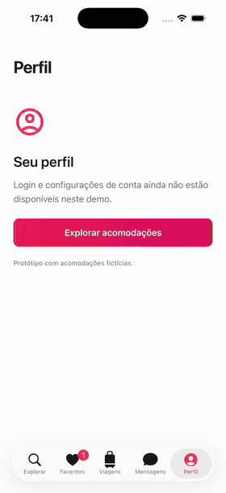

<div align="center">

# Airbnb NS

An Airbnb-inspired app built with NativeScript-Vue and [vue-router-ns](https://github.com/rafaelaugustos/vue-router-ns).

[](https://nativescript.org)
[](https://nativescript-vue.org)
[](https://github.com/rafaelaugustos/vue-router-ns)

<a href=".github/media/airbnb.mp4"></a>

**[Watch the 27-second walkthrough](.github/media/airbnb.mp4)**

</div>

This app puts my router, [vue-router-ns](https://github.com/rafaelaugustos/vue-router-ns), to work in a complete browsing flow: discover stays, preview a listing, save favorites, filter destinations and open details. The screens use native views and each tab has its own navigation stack.

The source is included here as a standalone project. It installs `vue-router-ns@0.1.0-rc.2` from npm; no checkout of the router repository is needed.

## Run it

Install Node.js 20.19.4+ and the [NativeScript CLI and platform tools](https://docs.nativescript.org/setup/). iOS requires macOS and Xcode; Android requires the Android SDK and JDK.

```sh
git clone https://github.com/rafaelaugustos/airbnb-nativescript-vue-router.git
cd airbnb-nativescript-vue-router
npm ci
npm run ios
# or: npm run android
```

Pick a device with `npm run ios -- --device <udid>` or `npm run android -- --device <serial>`. Icons, launch resources and the **Airbnb NS** app name are included in `App_Resources/`. The application ID is `org.nativescript.airbnbns`.

For a physical iOS device, configure your signing team in `App_Resources/iOS/build.xcconfig`. Material is declared in the Android Gradle configuration so native tabs and sheets are available in release builds too.

## What's inside

- A Portuguese home feed with horizontal destination carousels and accommodation photos.
- Five native tabs with public color props, a favorites badge and independent navigation stacks.
- Listing details with a photo gallery, host information, amenities and a fixed reservation bar. The tab bar hides while details are open on supported hosts.
- Native card-to-page zoom and gesture dismissal on supported iOS 18+ runtimes; shared-image transitions as the fallback, including Android.
- Long-press cards for a native iOS preview and favorite action. Android presents a popup menu.
- A search sheet that returns destination and price filters. Cancelling keeps the previous filters.
- Favorites, applied filters and the selected tab saved locally.
- Navigation snapshots and opted-in page state: vertical reading positions, the selected category and gallery photo.
- A per-page route loader using the bundled catalog, plus deferred rendering of the longer details section.

The catalog is offline. Listings are fictional, the reservation button shows a demo summary, and Trips, Messages and Profile are placeholders. There is no booking service, authentication or payment integration.

## How it uses vue-router-ns

| In the app                               | API                                                  | Source                                                                                     |
| ---------------------------------------- | ---------------------------------------------------- | ------------------------------------------------------------------------------------------ |
| Native tabs, labels, colors and badges   | `RouterTabs` + `RouterTab`                           | [App.vue](src/App.vue)                                                                     |
| Independent stacks and tap-again to root | Named `RouterView`, `backToRootOnReselect`           | [App.vue](src/App.vue)                                                                     |
| Full-screen listing details              | `meta.tabBarVisibility: 'hidden'`                    | [router.ts](src/router.ts)                                                                 |
| Card zoom and shared-image fallback      | `RouterLink zoom`, NativeScript `SharedTransition`   | [StayCard.vue](src/components/StayCard.vue)                                                |
| Preview and favorite actions             | `RouterLink menu`                                    | [StayPreview.vue](src/components/StayPreview.vue)                                          |
| Search sheet with a typed result         | `pushForResult<SearchFilters>()`, `back({ result })` | [Explore.vue](src/pages/Explore.vue), [Search.vue](src/pages/Search.vue)                   |
| Per-entry loading, error and retry       | Experimental `defineRouteLoader`, `useRouteData`     | [stay-data.ts](src/stay-data.ts), [Stay.vue](src/pages/Stay.vue)                           |
| Render details after navigation          | `Deferred`                                           | [Stay.vue](src/pages/Stay.vue)                                                             |
| Restore browsing state                   | `restore`, `usePageState`                            | [navigation-state.ts](src/navigation-state.ts), [page-scroll.ts](src/utils/page-scroll.ts) |
| Accessibility focus and modal return     | `useNavigationFocus`                                 | [Explore.vue](src/pages/Explore.vue), [Search.vue](src/pages/Search.vue)                   |
| Open links in the owning tab             | `links.frame`                                        | [router.ts](src/router.ts)                                                                 |

The rc.2 update removes the earlier native tab-styling workaround and enables `backToRootOnReselect` after the UIKit duplicate-selection fix. Tab visibility now comes from route metadata.

## Project layout

```text
src/
  app.ts                  App entry
  App.vue                 Native tabs and named stacks
  router.ts               Routes, links and restoration
  stay-data.ts            Offline route loader
  navigation-state.ts     Saved navigation snapshots
  store.ts                Favorites, filters and selected tab
  data.ts                 Fictional catalog
  pages/                  Explore, details, favorites and search
  components/             Cards, previews, gallery and reservation bar
  utils/                  Filtering, prices and saved scroll position
  assets/                 Bundled photos
  fonts/                  Material Icons and license
App_Resources/            iOS and Android native configuration and icons
.github/media/            Recorded walkthrough and README preview
```

## Deep links

The `airbnbns` scheme is configured on both platforms:

```sh
xcrun simctl openurl booted 'airbnbns://stays/tortuga'
xcrun simctl openurl booted 'airbnbns://saved'
```

On Android:

```sh
adb shell am start -a android.intent.action.VIEW -d 'airbnbns://stays/tortuga' org.nativescript.airbnbns
```

The router selects the matching tab before navigating. HTTPS app links are not configured.

## Build and checks

```sh
npm run typecheck
npm run bundle:ios
npm run bundle:android
npm run build:ios       # simulator build
npm run build:android   # debug APK
```

The video was recorded on an iPhone 17 / iOS 26 simulator with NativeScript Core 9.1.3, NativeScript-Vue 3.1.2 and vue-router-ns 0.1.0-rc.2. It shows native tabs, zoom and gesture return, context previews, favorite actions and scrolling. It is edited to 26.5 seconds without speeding up the animations.

Per-route hiding supports iOS 18+ bottom bars and Android Material bars/rails. UIKit sidebar mode and the Core fallback keep navigation visible. UIKit controls iOS 26 translucency and unselected-icon tint. Navigation snapshots expire after 24 hours; search sheets, pending result promises and horizontal carousel offsets are not restored.

The recorded flow does not cover cold-process restoration, loader failures, screen-reader announcements or Android gestures. Those need separate native checks.

## Assets

Photos are bundled illustrations from Unsplash and do not depict the fictional Brazilian listings:

| Asset            | Source                                                                   |
| ---------------- | ------------------------------------------------------------------------ |
| cabin.jpg        | [Unsplash](https://images.unsplash.com/photo-1449158743715-0a90ebb6d2d8) |
| beach.jpg        | [Unsplash](https://images.unsplash.com/photo-1613490493576-7fde63acd811) |
| mountain.jpg     | [Unsplash](https://images.unsplash.com/photo-1449844908441-8829872d2607) |
| loft.jpg         | [Unsplash](https://images.unsplash.com/photo-1600210492486-724fe5c67fb0) |
| pool.jpg         | [Unsplash](https://images.unsplash.com/photo-1576013551627-0cc20b96c2a7) |
| interior.jpg     | [Unsplash](https://images.unsplash.com/photo-1600607687920-4e2a09cf159d) |
| garden-house.jpg | [Unsplash](https://images.unsplash.com/photo-1564013799919-ab600027ffc6) |
| bedroom.jpg      | [Unsplash](https://images.unsplash.com/photo-1611892440504-42a792e24d32) |
| city-house.jpg   | [Unsplash](https://images.unsplash.com/photo-1568605114967-8130f3a36994) |

Material Icons Outlined comes from [Google's material-design-icons](https://github.com/google/material-design-icons); its [Apache 2.0 license](src/fonts/MaterialIcons-LICENSE.txt) is included.

Router issues belong in [vue-router-ns](https://github.com/rafaelaugustos/vue-router-ns/issues). App feedback belongs [here](https://github.com/rafaelaugustos/airbnb-nativescript-vue-router/issues).

---

By [Rafael Augusto](https://github.com/rafaelaugustos). Independent project, not affiliated with Airbnb.
