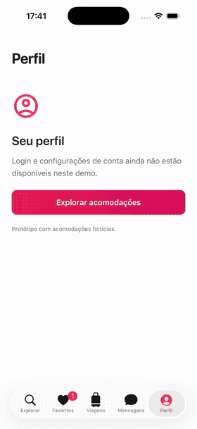

<div align="center">

# Airbnb NS

An Airbnb-inspired app built with NativeScript-Vue and [vue-router-ns](https://github.com/rafaelaugustos/vue-router-ns).

[](https://nativescript.org)
[](https://nativescript-vue.org)
[](https://github.com/rafaelaugustos/vue-router-ns)

<a href=".github/media/airbnb.mp4"></a>

**[Original browsing walkthrough](.github/media/airbnb.mp4)** · recorded before the stable showcase update

</div>

This app puts my router, [vue-router-ns](https://github.com/rafaelaugustos/vue-router-ns), to work in a complete browsing flow: discover stays, preview a listing, save favorites, filter destinations and open details. The screens use native views and each tab has its own navigation stack.

The source is included here as a standalone project. It installs `vue-router-ns@0.1.0` from npm; no checkout of the router repository is needed.

## Run it

Install Node.js 20.19.4+ and the [NativeScript CLI and platform tools](https://docs.nativescript.org/setup/). iOS requires macOS and Xcode; Android requires the Android SDK and JDK.

```sh
git clone https://github.com/rafaelaugustos/airbnb-nativescript-vue-router.git
cd airbnb-nativescript-vue-router
npm ci
npm run ios
# or: npm run android
```

Pick a device with `npm run ios -- --device <udid>` or `npm run android -- --device <serial>`. Icons, launch resources and the **Airbnb NS** app name are included in `App_Resources/`. The application ID is `org.nativescript.airbnbns`.

For a physical iOS device, configure your signing team in `App_Resources/iOS/build.xcconfig`. Material is declared in the Android Gradle configuration so native tabs and sheets are available in release builds too.

## What's inside

- A Portuguese home feed with horizontal destination carousels and accommodation photos.
- Five native tabs with public color props, a favorites badge and independent navigation stacks.
- Listing details with a photo gallery, host information, amenities and a fixed reservation bar. The tab bar hides while details are open on supported hosts.
- Native card-to-page zoom and gesture dismissal on supported iOS 18+ runtimes; shared-image transitions as the fallback, including Android.
- Long-press cards for a native iOS preview and favorite action. Android presents a popup menu.
- Shared favorite actions for card buttons and menus, also used by the detail gallery. Titles and availability stay reactive, and the router checks the owning page before dispatching.
- A search sheet that returns destination and price filters. Cancelling keeps the previous filters.
- Favorites, applied filters and the selected tab saved locally.
- Navigation snapshots and opted-in page state: vertical reading positions, the selected category and gallery photo.
- A per-page route loader using the bundled catalog, plus deferred rendering of the longer details section.

The catalog, reservations and conversations are offline demonstrations. Sign-in creates a local demo session; it does not authenticate against a server. Confirming a reservation stores a fictional trip on this device. Messages are local and are not sent to a real host. No payment or booking service is connected.

## Stable showcase update

The app now uses the published router **0.1.0**, NativeScript Core **9.1.4** and NativeScript-Vue **3.1.3**.

- **Trips:** plan a stay, change dates and guests, add a host note and confirm a local demo reservation. Confirmed trips appear in the Trips tab with a badge.
- **Invitations:** open the invitation in Messages. If signed out, the app suspends its navigation intent, presents sign-in and resumes the exact destination after the modal closes. Cancelling sign-in preserves the invitation and does not navigate to the protected destination.
- **History:** the clock button and a long press on Back open the page's native history menu. Selecting a previous entry runs the same unsaved-change guard as ordinary Back.
- **Editing:** changing dates or guests creates a draft. The guest sheet returns a typed result; cancellation keeps the previous guest count. Leaving without saving offers Continue editing or Discard. Saved changes are reflected by the retained trip page.
- **Messages:** open a host conversation, follow its accommodation card and send local demo replies. Replies survive restarting the app; the store retains up to 30 messages in each of 12 conversations. Each tab keeps its own stack.
- **Preparation:** touching a stay card can prepare its lazy component and explicitly authorized public catalog data. Scrolling away cancels the interest. Profile lets you disable preparation; no protected data or navigation is triggered speculatively.
- **Diagnostics:** Profile opens a bounded recording of real navigation events. Inspect a frozen capture, move between observations and copy version 2 JSON for the router's offline viewer. Inspecting the capture never replays actions into the app.

Start at **Messages → Open invitation → Sign in and continue → Edit trip**. Change the guests, try the history button before saving, then confirm the demo reservation. The Profile tab contains sign-out and the diagnostic tools.

Navigation intents/auth resumption, code/data preparation and diagnostic recording retain their documented **experimental** status. This app's demo session and local reservation store are application code, not authentication or booking services supplied by the router. Multi-window and custom native hosts are not enabled by this phone showcase.

## How it uses vue-router-ns

| In the app                               | API                                                      | Source                                                                                                                                       |
| ---------------------------------------- | -------------------------------------------------------- | -------------------------------------------------------------------------------------------------------------------------------------------- |
| Native tabs, labels, colors and badges   | `RouterTabs` + `RouterTab`                               | [App.vue](src/App.vue)                                                                                                                       |
| Independent stacks and tap-again to root | Named `RouterView`, `backToRootOnReselect`               | [App.vue](src/App.vue)                                                                                                                       |
| Full-screen listing details              | `meta.tabBarVisibility: 'hidden'`                        | [router.ts](src/router.ts)                                                                                                                   |
| Card zoom and shared-image fallback      | `RouterLink zoom`, NativeScript `SharedTransition`       | [StayCard.vue](src/components/StayCard.vue)                                                                                                  |
| Preview and favorite actions             | `RouterLink menu`                                        | [StayPreview.vue](src/components/StayPreview.vue)                                                                                            |
| Shared favorite state and dispatch       | `usePageActions`, `actions.menu()`, `actions.dispatch()` | [stay-actions.ts](src/utils/stay-actions.ts), [StayCard.vue](src/components/StayCard.vue), [StayGallery.vue](src/components/StayGallery.vue) |
| Search sheet with a typed result         | `pushForResult<SearchFilters>()`, `back({ result })`     | [Explore.vue](src/pages/Explore.vue), [Search.vue](src/pages/Search.vue)                                                                     |
| Per-entry loading, error and retry       | Experimental `defineRouteLoader`, `useRouteData`         | [stay-data.ts](src/stay-data.ts), [Stay.vue](src/pages/Stay.vue)                                                                             |
| Render details after navigation          | `Deferred`                                               | [Stay.vue](src/pages/Stay.vue)                                                                                                               |
| Restore browsing state                   | `restore`, `usePageState`                                | [navigation-state.ts](src/navigation-state.ts), [page-scroll.ts](src/utils/page-scroll.ts)                                                   |
| Accessibility focus and modal return     | `useNavigationFocus`                                     | [Explore.vue](src/pages/Explore.vue), [Search.vue](src/pages/Search.vue)                                                                     |
| Open links in the owning tab             | `links.frame`                                            | [router.ts](src/router.ts)                                                                                                                   |

Favorite buttons and context menus use the page-action API introduced in rc.3. Each routed page provides a registry keyed by listing ID, while saved listings remain in the shared app store. Registering during page setup also covers cards added later by filters or favorites and galleries mounted after a loader resolves. The router blocks dispatch from covered or inactive pages and during pending navigation, and prevents overlapping execution within a registry. Card previews rebind when the listing changes. The stable showcase adds the flows above while preserving these browsing interactions.

| Stable showcase flow               | API                                                                        | Source                                                                         |
| ---------------------------------- | -------------------------------------------------------------------------- | ------------------------------------------------------------------------------ |
| Invitation and login continuation  | Experimental `notificationIntent`, `suspendIntent`, `resume`, `openIntent` | [navigation.ts](src/navigation.ts), [Login.vue](src/pages/Login.vue)           |
| Page-owned Back history            | `useBackHistoryMenu`, `history`, exact-entry Back                          | [JourneyHeader.vue](src/components/JourneyHeader.vue)                          |
| Protected edit and guest selection | `onBeforeRouteLeave`, `pushForResult`, `back({ result })`, `usePageState`  | [TripEditor.vue](src/pages/TripEditor.vue), [Guests.vue](src/pages/Guests.vue) |
| Prepare a catalog destination      | Experimental `useRoutePreload`, `useRouteDataPreload`, loader permission   | [StayCard.vue](src/components/StayCard.vue), [stay-data.ts](src/stay-data.ts)  |
| Capture and inspect navigation     | Experimental `diagnostics.recording`, `checkpoint`                         | [Diagnostics.vue](src/pages/Diagnostics.vue)                                   |

## Project layout

```text
src/
  app.ts                  App entry
  App.vue                 Native tabs and named stacks
  router.ts               Routes, links and restoration
  stay-data.ts            Offline route loader
  navigation.ts           Protected destinations and suspended invitations
  navigation-state.ts     Saved navigation snapshots
  travel-state.ts         Local demo session, reservations and conversations
  store.ts                Favorites, filters and selected tab
  data.ts                 Fictional catalog
  pages/                  Browse, trips, editor, sheets, conversations and profile
  components/             Cards, previews, gallery and native Back history
  utils/                  Filtering, prices, page actions and saved scroll position
  assets/                 Bundled photos
  fonts/                  Material Icons and license
App_Resources/            iOS and Android native configuration and icons
scripts/native/           XCTest and adb/UIAutomator acceptance checks
.github/media/            Original recorded walkthrough and README preview
```

## Deep links

The `airbnbns` scheme is configured on both platforms:

```sh
xcrun simctl openurl booted 'airbnbns://stays/tortuga'
xcrun simctl openurl booted 'airbnbns://saved'
xcrun simctl openurl booted 'airbnbns://trips/brisa'
```

On Android:

```sh
adb shell am start -a android.intent.action.VIEW -d 'airbnbns://stays/tortuga' org.nativescript.airbnbns
```

The router selects the matching tab before navigating. Trip and conversation links require the local demo session and continue to their original destination after sign-in. HTTPS app links are not configured.

## Build and checks

```sh
npm run typecheck
npm run bundle:ios
npm run bundle:android
npm run build:ios       # simulator build
npm run build:android   # debug APK
```

The stable showcase was validated on November 18, 2026 with Vue SFC type checking, both platform bundles and native builds. Native acceptance checks passed on an iPhone 17 Pro / iOS 26.2 simulator (3 tests, 0 failures) and a Pixel 7 / Android API 36 emulator (31 interaction steps). Both platforms exercised invitation cancellation and continuation, guest sheet cancellation and results, unsaved-change guards through history, reservation confirmation, diagnostics and sign-out. iOS also checked opening a prepared catalog card, message persistence after process restart, JSON export and a protected system deep link.

The checks use the real application UI; they do not record video. Run the iOS suite with Xcode, an installed iOS 26.2 runtime and Ruby's `xcodeproj` gem (also installed with CocoaPods):

```sh
npm run test:ios
```

The runner creates and removes its own simulator. Override `IOS_RUNTIME`, `IOS_DEVICE_TYPE`, `RUBY` or `OUT` when needed. Results and screenshot attachments remain in the printed temporary directory.

For Android, build and install the APK on a dedicated Pixel 7 / API 36 emulator with a fresh app installation, then run:

```sh
npm run build:android
adb -s <serial> install platforms/android/app/build/outputs/apk/debug/app-debug.apk
ANDROID_SERIAL=<serial> npm run test:android
```

The Android driver requires Python 3 and `adb` on `PATH` (or an `ADB` override). It assumes a signed-out app with no saved trip; it never clears device data. Results and screenshots go to `OUT` or `/tmp/airbnb-showcase-android`.

The video was recorded on an iPhone 17 / iOS 26 simulator with NativeScript Core 9.1.3, NativeScript-Vue 3.1.2 and vue-router-ns 0.1.0-rc.2. It shows native tabs, zoom and gesture return, context previews, favorite actions and scrolling. It is edited to 26.5 seconds without speeding up the animations.

Per-route hiding supports iOS 18+ bottom bars and Android Material bars/rails. UIKit sidebar mode and the Core fallback keep navigation visible. UIKit controls iOS 26 translucency and unselected-icon tint. Navigation snapshots expire after 24 hours; search sheets, pending result promises and horizontal carousel offsets are not restored.

The original video does not demonstrate the stable showcase additions. The new acceptance checks cover conversation restoration after restarting the process; loader failure recovery, screen-reader announcements, Android system deep links and gesture-only navigation remain outside this app's current native acceptance suite.

## Assets

Photos are bundled illustrations from Unsplash and do not depict the fictional Brazilian listings:

| Asset            | Source                                                                   |
| ---------------- | ------------------------------------------------------------------------ |
| cabin.jpg        | [Unsplash](https://images.unsplash.com/photo-1449158743715-0a90ebb6d2d8) |
| beach.jpg        | [Unsplash](https://images.unsplash.com/photo-1613490493576-7fde63acd811) |
| mountain.jpg     | [Unsplash](https://images.unsplash.com/photo-1449844908441-8829872d2607) |
| loft.jpg         | [Unsplash](https://images.unsplash.com/photo-1600210492486-724fe5c67fb0) |
| pool.jpg         | [Unsplash](https://images.unsplash.com/photo-1576013551627-0cc20b96c2a7) |
| interior.jpg     | [Unsplash](https://images.unsplash.com/photo-1600607687920-4e2a09cf159d) |
| garden-house.jpg | [Unsplash](https://images.unsplash.com/photo-1564013799919-ab600027ffc6) |
| bedroom.jpg      | [Unsplash](https://images.unsplash.com/photo-1611892440504-42a792e24d32) |
| city-house.jpg   | [Unsplash](https://images.unsplash.com/photo-1568605114967-8130f3a36994) |

Material Icons Outlined comes from [Google's material-design-icons](https://github.com/google/material-design-icons); its [Apache 2.0 license](src/fonts/MaterialIcons-LICENSE.txt) is included.

Router issues belong in [vue-router-ns](https://github.com/rafaelaugustos/vue-router-ns/issues). App feedback belongs [here](https://github.com/rafaelaugustos/airbnb-nativescript-vue-router/issues).

---

By [Rafael Augusto](https://github.com/rafaelaugustos). Independent project, not affiliated with Airbnb.
